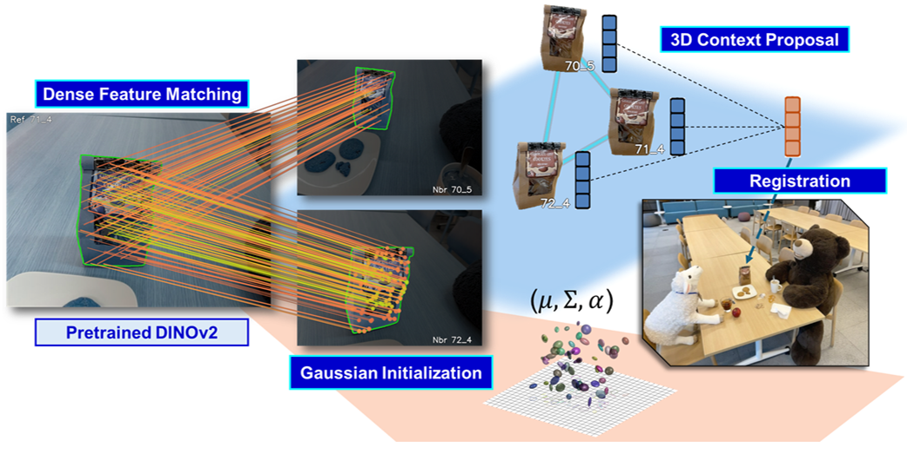
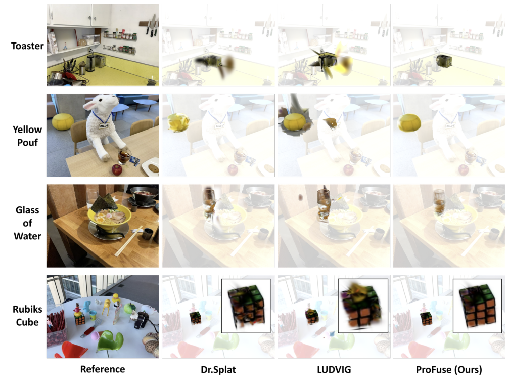
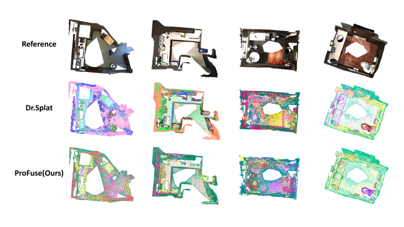

<div align="center">

# ProFuse: Efficient Cross-View Context Fusion for Open-Vocabulary 3D Gaussian Splatting

### 🏆 Accepted to WACV 2027

[**Yen-Jen Chiou**](https://github.com/chiou1203) &nbsp;·&nbsp; **Wei-Tse Cheng** &nbsp;·&nbsp; **Yuan-Fu Yang**

**National Yang Ming Chiao Tung University**

[remi.ii13@nycu.edu.tw](mailto:remi.ii13@nycu.edu.tw) &nbsp;·&nbsp; [andy5552555.ii13@nycu.edu.tw](mailto:andy5552555.ii13@nycu.edu.tw) &nbsp;·&nbsp; [yfyangd@nycu.edu.tw](mailto:yfyangd@nycu.edu.tw)

<br>

[](https://arxiv.org/abs/2601.04754)
[](https://arxiv.org/abs/2601.04754)
[](https://chiou1203.github.io/ProFuse/)
[](https://huggingface.co/papers/2601.04754)
[](https://huggingface.co/spaces/remiii25/ProFuse_Open-Vocabulary_Demo)
[](https://colab.research.google.com/drive/16DRjfcYU_ZAJTzn8J1AnZl3rcwqGGPnJ?copy=true)

</div>

<br>



ProFuse is an efficient context-aware framework for open-vocabulary 3D scene understanding with 3D Gaussian Splatting. The pipeline enhances a direct registration setup with a dense correspondence–guided pre-registration phase, adding minimal overhead and requiring no render-supervised fine-tuning.

## 📢 News

- **[2026.11]** 🎉 ProFuse is accepted to **WACV 2027**!
- **[2026.01]** Paper is available on [arXiv](https://arxiv.org/abs/2601.04754). Try the [Hugging Face Demo](https://huggingface.co/spaces/remiii25/ProFuse_Open-Vocabulary_Demo) or run on your own scene with the [Colab Demo](https://colab.research.google.com/drive/16DRjfcYU_ZAJTzn8J1AnZl3rcwqGGPnJ?copy=true).

## 0. Installation
Clone the repo

```bash
git clone https://github.com/chiou1203/ProFuse.git
cd ProFuse
```

Setup

```bash
pip install torch torchvision torchaudio --index-url https://download.pytorch.org/whl/cu124
pip install fused-local-corr==0.1.1 pycolmap hydra-core tqdm torchmetrics lpips matplotlib rich plyfile \
            imageio imageio-ffmpeg plotly scikit-learn moviepy==2.1.1 ffmpeg numpy==1.26.4 open_clip_torch
pip install -q --no-deps loguru
```

Install submodules for pre-registration

```bash
cd ProFuse/pre_registration

mkdir -p submodules

git clone --recursive https://github.com/Parskatt/RoMa.git submodules/RoMa
git clone --recursive https://github.com/chiou1203/gaussian-splatting submodules/gaussian-splatting
cd submodules/gaussian-splatting
git checkout profuse-v1

cd ProFuse/pre_registration
pip install -q submodules/gaussian-splatting/submodules/diff-gaussian-rasterization
pip install -q --no-deps submodules/RoMa
```

Install submodules for registration

```bash
cd ProFuse/feature_registration
pip install -q submodules/langsplat-rasterization \
                submodules/segment-anything-langsplat \
                submodules/simple-knn \
                ninja kmeans_pytorch faiss-cpu
```

## 1. Data preparation
For pre-registration, prepare the scene folder like the following:

```text
data_root/
├─ images/
├─ sparse/
└─ language_features/
```

For registration, move the 3DGS scene folder to data root:

```text
data_root/
├─ images/
├─ sparse/
├─ language_features/
├─ GS/
└─ input.ply
```

## 2. Pre-registration
You can run the following script for pre-registration.
Please replace `scene_dir` with your own dataset directory.
```bash
chmod +x pre_registration.sh
./pre_registration.sh --scene_dir /content/ramen
```
After pre-registration is done, the Gaussian scene will be under the `out_pre_registration` folder, and 3D Context Proposal related metadata will be written into the `language_features` folder.

## 3. Feature registration
You can run the following script to do feature registration.
Please make sure both the GS folder and the language feature folder with context proposal metadata exist.
```bash
chmod +x registration.sh
./registration.sh
```

## 4. 3D object selection


## 5. 3D point cloud understanding


## 6. Citation
If you find our work useful, please consider cite it in your work.
```text
@misc{chiou2026profuseefficientcrossviewcontext,
      title={ProFuse: Efficient Cross-View Context Fusion for Open-Vocabulary 3D Gaussian Splatting}, 
      author={Yen-Jen Chiou and Wei-Tse Cheng and Yuan-Fu Yang},
      year={2026},
      eprint={2601.04754},
      archivePrefix={arXiv},
      primaryClass={cs.CV},
      url={https://arxiv.org/abs/2601.04754}, 
}
```
